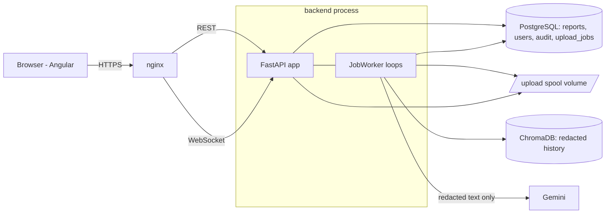
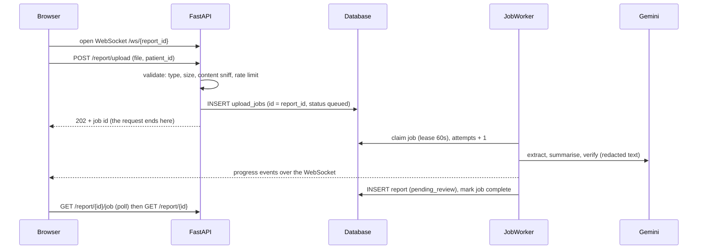
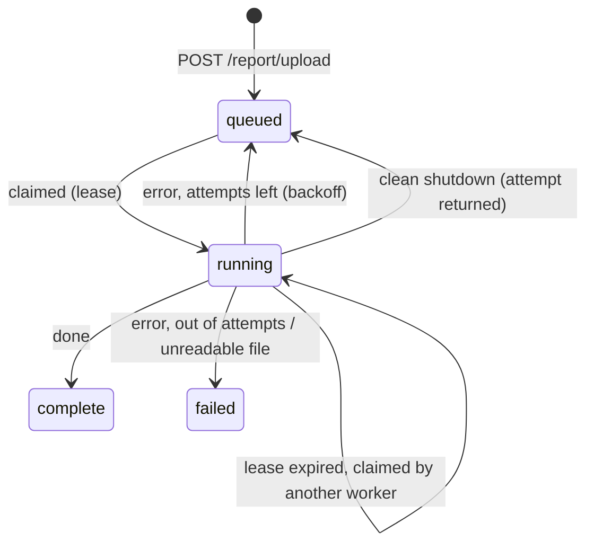

# MedSight design notes

Why the system is built the way it is, what happens when parts of it fail, and what it does not do yet.

## 1. What this is, and what it is not

A clinician-in-the-loop assistant for lab reports. A clinician uploads a report; the system extracts the values, flags abnormal ones against reference ranges and the patient's own history, drafts a clinical and a patient-friendly summary, and holds everything as **pending review** until a named clinician approves it. Patients can only ever see approved reports.

It is a prototype. It has only been run on synthetic reports, it is not a medical device, and nothing here has been validated for clinical use.

## 2. What shaped the design

In priority order:

1. **Safety**: unreviewed AI output never reaches a patient; every number in a summary must exist in the extracted data (deterministic check, independent of the model).
2. **Privacy**: patient identifiers are redacted before any model call and restored afterwards; logs and metrics carry ids and counts, never content.
3. **Integrity**: the audit log is tamper-evident and cannot silently fork.
4. **Availability when the model provider is slow or down**: an upload must not hang, vanish or be processed twice.
5. **Operability**: one request or job can be followed through the logs; the service reports whether it is alive and whether it is ready.
6. **Throughput**: deliberately last. Assumption (not measured): one clinic, tens of reports a day, bursts of a few dozen. A report takes tens of seconds, almost all of it model calls.

## 3. Architecture



nginx is the only published port. It overwrites `X-Forwarded-For`, so the client IP used for login throttling and the audit log cannot be spoofed. `/ready` and `/metrics` are not proxied.

## 4. Upload flow



The browser polls `/report/{id}/job` as well as listening on the WebSocket, so a dropped socket or a job handled by another process still completes correctly.

## 5. The job queue

Jobs are rows in `upload_jobs`. The protocol is in `backend/src/jobs/queue.py`, the runner in `backend/src/jobs/worker.py`.



- **At-least-once delivery.** A claimed job has a 60 s lease that the worker renews every 20 s. If the process dies, the lease runs out and another worker (or the restarted process) takes the job. Recovery takes at most one lease.
- **Idempotent work.** Because a job can run twice, the last step is safe to repeat: the report id is a primary key, a re-run that finds the report already saved just completes the job, and a lost race on the insert counts as success.
- **No stale writes.** Every state change a worker makes is guarded by `locked_by = <that worker>`. A worker that was paused and lost its lease cannot overwrite the worker that took over, and notices at the next heartbeat and abandons its run.
- **Retries.** Exponential backoff with jitter (15 s, 30 s, ...), 3 attempts by default. An unreadable file is a permanent error: it fails at once instead of repeating.
- **Back-pressure.** More than `JOB_QUEUE_MAX` queued or running jobs gives `503` with `Retry-After`. The number of reports analysed at once per process is `JOB_WORKERS`, so load on the model provider is a setting.

## 6. Decisions

| Decision | Alternatives | Why | Revisit when |
|---|---|---|---|
| Queue in the application database | Celery + Redis/RabbitMQ | The upload's state already lives in this database, so there is one system to run and back up, and the queue survives restarts for free. A table with the right index handles far more jobs than this workload creates. | Sustained hundreds of jobs per second, or many machines that should not all hit the primary. The queue API is the only code that knows how jobs are stored. |
| `FOR UPDATE SKIP LOCKED` plus a compare-and-swap UPDATE | Advisory locks, a single dispatcher | Workers never block each other and never take the same row; the compare-and-swap keeps it correct on SQLite too. | Never needed more than this so far. |
| Leases with heartbeats | A fixed timeout per job | Job time varies from seconds to minutes. A heartbeat detects a dead worker quickly without killing a slow but healthy job. | |
| 202 + job id; the job id is the report id | Hold the HTTP request open | A request held for a minute is cut by proxies, and ties up a connection while a model is slow. The client already opens the WebSocket under the report id before uploading. | |
| Hash-chained audit log with a UNIQUE `prev_hash` | Application lock only | A lock only works inside one process. The unique index makes forking the chain impossible across processes: the second writer is rejected, re-reads the head and retries. | A need to resist someone with direct database access: then ship the head hash to an external append-only store. |
| Redact before the model, restore after | Send the raw report | Patient identifiers never leave the process; the model only sees placeholders. | |
| Review state machine with a row lock | Free status edits | `pending -> approved/rejected`, `approved -> rejected`, `rejected` is final. Two clinicians clicking at once cannot both win. | |
| JWT + `token_version` checked on every request | Pure stateless JWT; server sessions | Password change, reset and deactivation revoke all existing tokens immediately, at the cost of one indexed lookup per request. | Very high request rates: cache the version for a few seconds. |
| SQLite for dev and tests, PostgreSQL for deployment | SQLite only | Concurrent writers (API, worker, audit) and row locks need a real server database. Tests use a file database with one connection per thread, so they exercise the same concurrency as production. | |

## 7. What happens when things fail

| Failure | Behaviour |
|---|---|
| Model provider slow or overloaded | Per-call timeout and retry/fallback model inside the model client; if the whole attempt fails, the job is retried with backoff, then fails with a reference id. The upload never hangs. |
| Worker process killed mid-job | Lease expires, the job is claimed again (attempt counter shows it). No manual cleanup. |
| Backend restarted or redeployed | Queued jobs are still in the database and the uploaded files are in the spool volume. A running job is returned to the queue on a clean shutdown without using an attempt. |
| Same job picked up twice | The second run finds the report saved and finishes; a simultaneous save loses on the primary key and is treated as success. |
| Same report id uploaded twice | The primary key rejects it: `409`. |
| Unreadable or corrupt file | Permanent error: fails on the first attempt, file deleted. |
| Database unreachable | `/ready` returns `503` so a load balancer stops sending traffic; `/health` stays `200` so the process is not killed for it. Workers back off and resume. |
| Audit write fails on a critical action (approval, delete) | The action fails. It never happens unaudited. |
| WebSocket drops | The browser keeps polling the job endpoint. |
| Queue is full | `503` + `Retry-After`; the rejected file is not kept. |

## 8. Concurrency and scaling

- Run several uvicorn processes and each runs its own `JobWorker`; the database guarantees no job is claimed twice. `JOB_WORKERS=0` makes a process accept uploads only.
- Per-process today, by design for one machine: WebSocket events (a job run by another process is followed by polling), the login/upload rate limiter, and metrics (scrape each process). Moving to several machines means a shared store for the limiter (Redis) and a shared spool (object storage).
- Blocking work (OCR, NER, embedding, vector writes, database access from the worker) runs in threads so one slow upload cannot freeze the event loop that serves every other request.

## 9. Observability

- Every request gets an id (`X-Request-ID`, an incoming one is accepted only if it is a plain token). Every log line shows `[req=... job=...]`.
- `/health` is liveness; `/ready` checks the database and the worker and returns queue counts.
- `/metrics` (Prometheus format) is off unless `METRICS_TOKEN` is set: requests by route template and status, request time, jobs claimed/finished/retried, lease losses, job duration, uploads accepted, queue depth by status. Labels are small fixed sets; no ids or names.

## 10. Known gaps

- Schema changes are not managed by migrations. New nullable columns are added automatically and indexes are created with idempotent DDL at start-up; renames and type changes need Alembic.
- The WebSocket token travels in the URL query string (browsers cannot set headers on a WebSocket). A one-time ticket would be better.
- The original filename is stored with the report and can contain a patient name.
- No load test against the real model provider; the benchmark below measures the queue only.
- Uploaded files in the spool are not encrypted at rest; the directory is private (0700) and files are deleted when the job ends.
- No two-factor authentication, no alert rules on the metrics.

## 11. Checking the claims

```
cd backend
python -m pytest -q                                   # unit and integration tests, incl. crash/retry/lease tests
python scripts/bench_queue.py --jobs 300 --workers 4 --work-ms 50
```

The benchmark prints throughput, efficiency against the theoretical ceiling, and queue wait percentiles for the machine it runs on. Quote your own numbers, with the hardware and database, not anyone else's.
